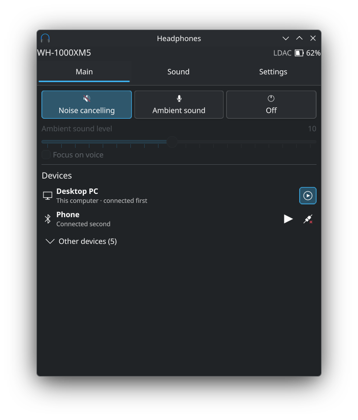
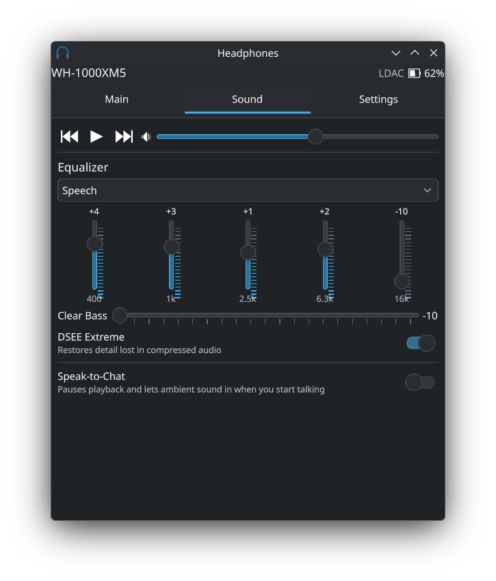
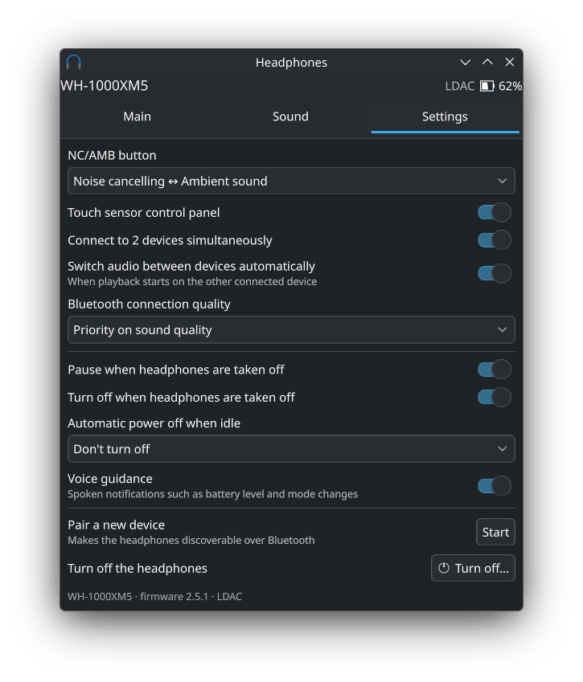

# Headphones for KDE Plasma

A Plasma 6 system tray widget and a small user daemon for controlling Bluetooth headphones without
the vendor apps: Sony, Samsung Galaxy Buds, AirPods and Beats, Pixel Buds, Nothing and CMF, Bose,
Soundcore, Huawei, Xiaomi, Sennheiser, Jabra and JBL.

| Main | Sound | Settings |
| --- | --- | --- |
|  |  |  |

- Noise cancelling / ambient sound / off, ambient level, focus on voice
- Battery of the headphones, both earbuds and the case; codec and firmware
- Paired devices (Sony): connection order, connect / disconnect, switch the playback source
- Playback control and volume
- Equalizer presets, custom equalizer bands, Clear Bass, DSEE Extreme
- Speak-to-Chat with sensitivity and timeout
- NC/AMB button function, touch controls, multipoint, automatic source switching,
  connection quality priority
- Pause or power off when taken off, automatic power off, voice guidance
- Touch lock, seamless connection and noise control with one earbud (Galaxy Buds)
- Pairing mode and powering the headphones off

The widget only shows what the connected model supports. It follows the system language
(English and Russian so far).

## Supported headphones

**Only the Sony WH-1000XM5 and the Samsung Galaxy Buds2 Pro have been tested with real hardware.**
Every other brand and model below is implemented from public protocol documentation and packet
captures and checked by unit tests, but has never been run against the actual device. The widget shows
an "untested" notice for these. If you try one, please
[report how it works](https://github.com/RodiAda/kde-headphones/issues).

| Brand | Models | Status | Protocol reference |
| --- | --- | --- | --- |
| Sony | WH-1000XM3–XM6, WF-1000XM3–XM6, WH-CH720N, WF-C510, WF-C700N, LinkBuds | XM5 tested | [libmdr](https://github.com/mos9527/SonyHeadphonesClient) (used as a library) |
| Samsung | Galaxy Buds, Buds+, Live, Pro, Buds2, Buds2 Pro, FE, Buds3, Buds3 Pro, Buds3 FE, Core, Buds4, Buds4 Pro | Buds2 Pro tested | [GalaxyBudsClient](https://github.com/timschneeb/GalaxyBudsClient) |
| Apple | AirPods 1–4, AirPods 4 (ANC), AirPods Pro, Pro 2, Pro 3, Max | untested | [LibrePods](https://github.com/librepods-org/librepods), [apple-wireshark](https://github.com/pabloaul/apple-wireshark) |
| Beats | Powerbeats Pro/Pro 2/Fit, Fit Pro, Studio Buds/Buds +, Solo Pro, Studio Pro, Beats 360 and others (battery) | untested | [MagicPodsCore](https://github.com/steam3d/MagicPodsCore), AppleDB |
| Google | Pixel Buds Pro, Pixel Buds Pro 2 | untested | [pbpctrl](https://github.com/qzed/pbpctrl) |
| Nothing / CMF | Ear (1), (2), (a), (3), (3a), Ear, Ear (stick), Ear (open), Headphone (1)/(1) Pro/(a), CMF Buds, Buds Pro/Pro 2, Buds 2/2 Plus/2a, Neckband Pro, Headphone Pro | untested | Gadgetbridge, [ear-web](https://github.com/radiance-project/ear-web), [omarchy-headphones](https://github.com/ncr/omarchy-headphones) |
| Bose | QC35/QC35 II, NC 700, QC45, QC Earbuds, QC Ultra headphones and earbuds (1st/2nd gen), Ultra Open, Sport earbuds | untested | [bosectl](https://github.com/aaronsb/bosectl), [based-connect](https://github.com/Denton-L/based-connect), Gadgetbridge |
| Anker Soundcore | Life Q30/Q35, Life Tune/Tune Pro, Space Q45, Space A40, Life Note 3/3S, Life P3, Life Dot 2 NC, Life A2 NC, Liberty Air 2 Pro, Liberty 4 NC, P30i/R50i NC | untested | [OpenSCQ30](https://github.com/Oppzippy/OpenSCQ30) |
| Huawei / Honor | FreeBuds Pro–Pro 5, Studio, 4, 4i, 5, 5i, 6, 6i, SE–SE 4, 3, FreeClip, FreeClip 2, FreeLace Pro/Pro 2, HONOR Earbuds 2 | untested | [OpenFreebuds](https://github.com/melianmiko/OpenFreebuds), [LibreBuds](https://github.com/librebuds) |
| Xiaomi / Redmi | Redmi Buds 3 Pro, 5 Pro, 6, 6 Pro, 6 Lite, 6 Active, 4 Active, REDMI Buds 8 Active; other Xiaomi Buds with a minimal layout | untested | Gadgetbridge |
| Sennheiser | MOMENTUM 4 Wireless, MOMENTUM 5 | untested | [momentum4-control](https://github.com/Ariazonaa/momentum4-control) |
| Jabra | Evolve2 55, Evolve2 65, Evolve2 85, Evolve 65 | untested | Gadgetbridge, [jabridge](https://github.com/Watchdog0x/jabridge) |
| JBL | Tour One M2, Live Pro 2, Tune Flex 2 and other models with the JBL Headphones app (over Bluetooth LE) | untested | [volume](https://github.com/xinutec/volume), [JblTray](https://github.com/emperorbug46/JblTray) |

Notes:

- Sony paired device management is MDR V2 only; BLE-only Sony devices are not supported.
- AirPods features that need the computer to identify itself as an Apple device (hearing aid,
  transparency customization) are left out.
- Not supported for lack of a public protocol description: Sennheiser true wireless earbuds, Jabra
  Elite earbuds, pre-Apple Beats, and several Soundcore models listed in the backend.
- JBL headphones are controlled over Bluetooth LE GATT; the daemon finds the LE side of a connected
  JBL device through BlueZ. Any connected device named "JBL" is tried, including speakers; devices that
  do not answer are skipped for 30 seconds.
- All protocol references were used for facts only (UUIDs, message layouts, test vectors); no code from
  them is included.

## Install

### Packages

Download the package for your distribution from the
[latest release](https://github.com/RodiAda/kde-headphones/releases/latest):

- Arch Linux and derivatives: `sudo pacman -U kde-headphones-*.pkg.tar.zst`
  (or build it yourself from [`packaging/arch/PKGBUILD`](packaging/arch/PKGBUILD))
- Debian 13 and newer: `sudo apt install ./kde-headphones_*.deb`
- Fedora: `sudo dnf install ./kde-headphones-*.rpm`

Then add the widget via *Configure System Tray → Entries → Headphones* (restart plasmashell with
`systemctl --user restart plasma-plasmashell` if it is not listed yet). The daemon is D-Bus activated:
the widget starts it on demand, nothing has to be enabled.

There is no Flatpak: Plasma widgets cannot be installed from a Flatpak, and the daemon needs raw
Bluetooth sockets and the system BlueZ bus, which the sandbox does not provide.

### From source

Build dependencies:

- Arch Linux: `sudo pacman -S --needed base-devel cmake ninja git qt6-base bluez-libs dbus gettext`
- Debian / Ubuntu: `sudo apt install build-essential cmake ninja-build git qt6-base-dev libbluetooth-dev libdbus-1-dev gettext`
- Fedora: `sudo dnf install gcc-c++ cmake ninja-build git qt6-qtbase-devel bluez-libs-devel dbus-devel gettext`

CMake 3.31 or newer and a C++20 compiler are required. The first build downloads
[{fmt}](https://github.com/fmtlib/fmt) for libmdr.

```
git clone --recurse-submodules https://github.com/RodiAda/kde-headphones.git
cd kde-headphones
./install.sh
```

`install.sh` installs into `~/.local` (no root needed) and enables the user unit; `./uninstall.sh`
removes it again. For a system-wide install use the usual
`cmake -B build -DCMAKE_INSTALL_PREFIX=/usr && cmake --build build && sudo cmake --install build`.

Middle-click the tray icon to cycle the noise mode. The widget hides itself while no supported
headphones are connected.

## Releases

Pushing a `v*` tag that matches the version in `CMakeLists.txt` makes GitHub Actions build the Arch,
Debian and Fedora packages and publish them as a release. Every push runs the build and the tests.

## D-Bus

The daemon runs on the session bus as `io.github.rodiada.Headphones`, object `/io/github/rodiada/Headphones`.

```
busctl --user introspect io.github.rodiada.Headphones /io/github/rodiada/Headphones
busctl --user call io.github.rodiada.Headphones /io/github/rodiada/Headphones io.github.rodiada.Headphones CycleMode
```

`CycleMode` works well as a global shortcut (*System Settings → Shortcuts → Add Command*).

Properties: `Connected`, `Vendor` (sony | samsung), `DeviceName`, `Address`, `Battery` (-1 when unknown;
the lower earbud on true wireless models), `Batteries` (JSON array of `part`: main | left | right | case,
`level`, `charging`), `Modes` (JSON array of the noise modes the model supports), `Mode`
(`noise-cancelling` | `ambient` | `off` | `adaptive`), `AmbientLevel`, `FocusOnVoice`, `Devices` (JSON array
of `mac`, `name`, `connected`, `order`, `active`, `self`), `DeviceAction` (JSON describing the last
connect/disconnect: `pending` → `in-progress` → `ok` | `error` | `busy`), `Settings` (JSON with every
supported setting; `ambient` gives the level range), `Alert` (non-empty while the headphones wait for a
confirmation), `Paired` (JSON array of paired supported headphones with `name`, `address`, `connected` and
`state`: connecting | failed; filled only while no headphones are connected).

Methods: `SetMode(s)`, `SetAmbientLevel(i)`, `SetFocusOnVoice(b)`, `CycleMode()`, `SwitchPlayback(s mac)`,
`ConnectDevice(s mac)`, `DisconnectDevice(s mac)`, `Apply(s json)`, `Playback(s play|pause|next|previous)`,
`PowerOff()`, `RespondToAlert(b)`, `ConnectHeadphones(s address)` (asks BlueZ to connect paired headphones).

`Apply` takes a partial object with the same shape as `Settings`:

```
busctl --user call io.github.rodiada.Headphones /io/github/rodiada/Headphones io.github.rodiada.Headphones \
    Apply s '{"speakToChat":{"enabled":true,"timeout":"long"},"dsee":true}'
```

Sony keys: `speakToChat` {`enabled`, `sensitivity`: auto | high | low, `timeout`: short | medium | long | manual},
`equalizer` {`preset`, `bands`, `clearBass`}, `dsee`, `noiseButton` (nc-ambient-off | nc-ambient | nc-off |
ambient-off), `power` {`autoPowerOff`: 0 | 5 | 15 | 30 | 60 | 180, `offWhenRemoved`, `autoPause`},
`voiceGuidance` {`enabled`, `volume`}, `connectionMode` (quality | stability), `autoSwitch`, `pairing`,
`volume` (0..30), `general` {"<index>": bool}.

Galaxy Buds keys: `equalizer` {`preset`}, `touchLock`, `seamless`, `oneEarbudNoise`.

## Notes

- The daemon picks the first connected BlueZ device that exposes a known control service and retries
  every 5 seconds. Galaxy Buds+, Live and Pro use the generic serial port service, so they are matched
  by name as well.
- The headphones accept a single control connection. If a phone holds it (Sound Connect or Galaxy
  Wearable open), the daemon cannot connect.
- The daemon refuses to disconnect the computer it runs on, since that would drop the control link.
- Galaxy Buds refuse noise cancelling and ambient sound with only one earbud worn unless
  *Noise control with one earbud* is on; the widget shows a hint in that case.
- libmdr does not expose the connection order or the result of connect/disconnect; the daemon reads
  both from raw packets.
- Play/pause gestures on the headphones (double tap on Sony, tap on Galaxy Buds) send separate *play* and
  *pause* commands chosen from the playback state the computer reports over AVRCP. Without a registered
  player the headphones guess and get out of sync whenever playback is paused elsewhere, so the gesture
  has to be repeated. `headphonesd.service` therefore pulls in BlueZ's `mpris-proxy.service`
  (`bluez-utils` on Arch, `bluez` on Debian and Fedora), which reports the state of MPRIS players.
- The last Sony ambient level is kept in `~/.config/io.github.rodiada/headphonesd.conf`, because the
  headphones do not report it while noise cancelling is on.
- Logs: `journalctl --user -u headphonesd`. Frame dumps for Galaxy Buds:
  `systemctl --user set-environment QT_LOGGING_RULES=headphonesd.debug=true` and restart the unit.

## Translations

Strings are written in English and translated through gettext catalogs in `po/` (domain
`plasma_applet_io.github.rodiada.headphones`); `install.sh` compiles them into the widget package.

```
xgettext --from-code=UTF-8 -C -kde -ki18n:1 -ki18nc:1c,2 -o po/plasma_applet_io.github.rodiada.headphones.pot \
    plasmoid/io.github.rodiada.headphones/contents/ui/*.qml
msgmerge -U po/ru.po po/plasma_applet_io.github.rodiada.headphones.pot
```

A new language is a new `po/<lang>.po`.

## Tests

```
cmake -B build-test -DHEADPHONES_TESTS=ON && cmake --build build-test --target galaxy-test && build-test/galaxy-test
```

The Galaxy backend test replays extended status frames from eight earbuds. The Buds2 Pro frame
labelled C3D4 was captured for this project; the others come from the test data of
[GalaxyBudsClient](https://github.com/timschneeb/GalaxyBudsClient), which also served as the reference
for the Galaxy Buds protocol. No GalaxyBudsClient code is used.

## Disclaimer

This project is not affiliated with, endorsed by or connected to Sony or Samsung. Product names are
trademarks of their owners. The protocols were reverse engineered; use at your own risk.

## License

MIT, see [LICENSE](LICENSE). libmdr is MIT licensed by its authors.
